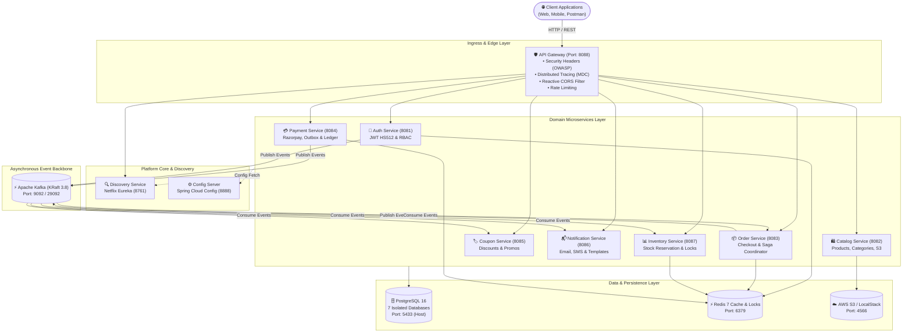

# 👗 Fashion E-Commerce Microservices Platform

[](https://openjdk.org/)
[](https://spring.io/projects/spring-boot)
[](https://spring.io/projects/spring-cloud)
[](https://www.postgresql.org/)
[](https://redis.io/)
[](https://kafka.apache.org/)
[](https://www.docker.com/)
[](https://kubernetes.io/)

An enterprise-grade, high-throughput, event-driven e-commerce platform architected as a distributed multi-module microservices ecosystem using **Java 21**, **Spring Boot 4**, **Spring Cloud**, **PostgreSQL 16**, **Redis 7**, **Apache Kafka (KRaft mode)**, and **AWS S3 / LocalStack**.

---

## 📑 Table of Contents
1. [Architecture Overview](#-architecture-overview)
2. [Architectural Patterns & Highlights](#-architectural-patterns--highlights)
3. [Service Catalog & Port Matrix](#-service-catalog--port-matrix)
4. [Event-Driven Messaging & Kafka Topics](#-event-driven-messaging--kafka-topics)
5. [Directory Layout](#-directory-layout)
6. [Prerequisites](#-prerequisites)
7. [Environment Configuration](#-environment-configuration)
8. [Getting Started (Step-by-Step)](#-getting-started-step-by-step)
9. [Running with Docker Compose](#-running-with-docker-compose)
10. [Kubernetes Deployment](#-kubernetes-deployment)
11. [Security & Authentication](#-security--authentication)
12. [Postman Collections & API Testing](#-postman-collections--api-testing)
13. [Observability & Monitoring](#-observability--monitoring)

---

## 🏛 Architecture Overview



---

## 🌟 Architectural Patterns & Highlights

* **Database-per-Service**: Complete schema and storage isolation. Each microservice manages its dedicated database schema (`auth_db`, `catalog_db`, `order_db`, etc.) with zero cross-database queries or foreign keys.
* **Transactional Outbox Pattern**: Eliminates dual-write inconsistencies. Outbox events are committed atomically alongside business state changes into an `outbox_events` table and polled/published asynchronously via Kafka.
* **Distributed Locks with Redis**: High-concurrency inventory reservation and idempotent payment verification using Redis-backed distributed locks to prevent race conditions and double charging.
* **Saga Pattern (Choreographed)**: Handles long-running multi-service transactions (Order Placement $\rightarrow$ Stock Reservation $\rightarrow$ Payment Processing $\rightarrow$ Order Confirmation) with automated compensation upon failure.
* **Reactive Gateway Ingress**: Built with Spring Cloud Gateway (Project Reactor / Netty), applying strict OWASP security headers, non-blocking CORS configuration, and uniform route routing.
* **Distributed Tracing & Correlation**: Unique `X-Correlation-Id` is stamped at the gateway boundary, propagated down Feign and Kafka headers, and bound to SLF4J `MDC` context for seamless multi-service log querying.
* **Zero-Leak Centralized Error Handling**: Unified `@RestControllerAdvice` in `common-core` wraps all responses into a standardized `ApiResponse<T>` envelope, masking JVM internal traces and standardizing validation errors.

---

## 🌐 Service Catalog & Port Matrix

| Service / Component | Port | Database | Primary Responsibility |
| :--- | :--- | :--- | :--- |
| **`discovery-service`** | `8761` | — | Netflix Eureka Service Registry & Service Discovery |
| **`config-server`** | `8888` | — | Centralized Spring Cloud configuration repository |
| **`api-gateway`** | `8088` | — | Reactive edge ingress, correlation tracing, security headers |
| **`auth-service`** | `8081` | `auth_db` | User identity, registration, JWT HS512 tokens, RBAC permissions |
| **`catalog-service`** | `8082` | `catalog_db` | Product catalog, categories, brand filtering, S3 media uploads |
| **`order-service`** | `8083` | `order_db` | Cart management, order lifecycles, and saga coordination |
| **`payment-service`** | `8084` | `payment_db` | Razorpay gateway integration, payment verification, outbox table |
| **`coupon-service`** | `8085` | `coupon_db` | Voucher management, promo code calculation, usage limits |
| **`notification-service`** | `8086` | `notification_db` | Asynchronous email/SMS dispatch with HTML templates |
| **`inventory-service`** | `8087` | `inventory_db` | Stock reservations, inventory tracking, concurrency protection |
| **`PostgreSQL 16`** | `5433` (Host) | All 7 DBs | Multi-tenant isolated database container |
| **`Redis 7`** | `6379` | — | Distributed lock engine, token blacklist, query caching |
| **`Apache Kafka (KRaft)`** | `9092` | — | Event streaming message broker in ZooKeeper-less mode |
| **`LocalStack AWS S3`** | `4566` | — | S3 emulation for product asset uploads and media storage |

---

## ⚡ Event-Driven Messaging & Kafka Topics

The platform operates on **Apache Kafka 3.8 in KRaft mode** (no ZooKeeper dependency required).

| Kafka Topic | Producer | Consumer(s) | Trigger / Description |
| :--- | :--- | :--- | :--- |
| `auth.user-registered.v1` | `auth-service` | `notification-service` | Emits when a user completes registration; triggers welcome email. |
| `order.created.v1` | `order-service` | `inventory-service`, `payment-service` | Triggers stock reservation and payment session initiation. |
| `inventory.reserved.v1` | `inventory-service` | `order-service` | Confirms items are safely held for checkout. |
| `inventory.reservation-failed.v1` | `inventory-service` | `order-service` | Triggers order cancellation and compensation. |
| `payment.initiated.v1` | `payment-service` | `order-service` | Emits when Razorpay checkout session is created. |
| `payment.verified.v1` | `payment-service` | `order-service`, `notification-service` | Payment succeeded; confirms order and dispatches order invoice. |
| `payment.rejected.v1` | `payment-service` | `order-service` | Payment failed; triggers order cancellation and releases stock. |
| `coupon.redeemed.v1` | `order-service` | `coupon-service` | Decrements coupon available quota upon confirmed checkout. |

---

## 📦 Directory Layout

```text
FashionEcommerce-Microservices/
├── .env.example                               # Master environment configuration template
├── .gitignore                                 # Enterprise-grade git ignore definitions
├── README.md                                  # Platform master documentation
├── run-docker.bat                             # Root helper to start dockerized stack
├── run-infra.bat                              # Root helper to start infrastructure containers
│
├── auth-service-postman-collection.json       # Auth service standalone test collection
├── catalog-service-postman-collection.json    # Catalog service standalone test collection
├── coupon-service-postman-collection.json     # Coupon service standalone test collection
├── inventory-service-postman-collection.json  # Inventory service standalone test collection
│
└── fashion-parent/                            # Maven multi-module root
    ├── pom.xml                                # Central Bill of Materials (BOM) & dependency management
    ├── docker-compose.yml                     # Unified multi-compose file
    ├── docker-compose.infra.yml               # Postgres, Redis, Kafka KRaft, LocalStack
    ├── docker-compose.services.yml            # Container definitions for all 8 domain services
    ├── init-multiple-dbs.sh                   # Automated Postgres init script for 7 DBs
    ├── fashion-ecommerce-master-postman-collection.json # End-to-end master collection
    │
    ├── common-core/                           # Shared utility library (ApiResponse, Exceptions, MDC)
    ├── common-events/                         # Shared Kafka event DTO contracts
    │
    ├── discovery-service/                     # Netflix Eureka Service Registry (Port 8761)
    ├── config-server/                         # Spring Cloud Central Config (Port 8888)
    ├── api-gateway/                           # Spring Cloud Gateway (Port 8088)
    ├── auth-service/                          # Identity & Access Management (Port 8081)
    ├── catalog-service/                       # Products & Categories (Port 8082)
    ├── order-service/                         # Order Processing & Cart (Port 8083)
    ├── payment-service/                       # Payment Gateway & Outbox (Port 8084)
    ├── coupon-service/                        # Promotional Discounts (Port 8085)
    ├── inventory-service/                     # Stock Reservation Engine (Port 8087)
    ├── notification-service/                  # Email & SMS Dispatcher (Port 8086)
    │
    └── k8s/                                   # Kubernetes cluster manifests
        ├── base/                              # Namespace, secrets, configmaps
        ├── ingress.yaml                       # Cluster ingress rules
        └── services/                          # Service & deployment specs
```

---

## 💻 Prerequisites

Ensure you have the following installed on your workstation:
* **Java Development Kit (JDK)**: `Java 21` (or `Java 20+`)
* **Docker Desktop**: Version 24+ & Docker Compose v2+
* **Git**: Version 2.30+
* **Postman**: For executing the provided API test suites

---

## ⚙️ Environment Configuration

1. Create your local environment configuration file from the template:
   ```bash
   cp .env.example .env
   # Or inside fashion-parent:
   cp fashion-parent/.env.example fashion-parent/.env
   ```
2. Populate the required credentials:
   * `DB_PASSWORD`: Set your PostgreSQL admin password.
   * `APP_JWT_SECRET`: Generate a secure 64-byte secret string for HMAC-SHA512.
   * `MAIL_USERNAME` & `MAIL_PASSWORD`: Configure SMTP credentials (e.g. Gmail App Password).
   * `RAZORPAY_KEY_ID` & `RAZORPAY_KEY_SECRET`: Razorpay test keys (optional for mock testing).

---

## 🚀 Getting Started (Step-by-Step)

### Step 1: Start Infrastructure Containers
Start PostgreSQL, Redis, Kafka (KRaft), and LocalStack using Docker Compose:

```bash
cd fashion-parent
docker compose -f docker-compose.infra.yml up -d
```

Verify that all containers are healthy:
```bash
docker compose -f docker-compose.infra.yml ps
```

### Step 2: Build the Multi-Module Project
Build all services and install shared modules (`common-core`, `common-events`) using the Maven Wrapper:

```bash
# Windows
.\mvnw.cmd clean install -DskipTests

# Linux / macOS
./mvnw clean install -DskipTests
```

### Step 3: Service Startup Order
To ensure proper discovery and configuration resolution, start services in the following order:

1. **`discovery-service`** (`http://localhost:8761`) — Verify Eureka dashboard is accessible.
2. **`config-server`** (`http://localhost:8888`) — Central configuration engine.
3. **`api-gateway`** (`http://localhost:8088`) — Edge ingress proxy.
4. **Domain Services** (in parallel or any order):
   - `auth-service` (Port 8081)
   - `catalog-service` (Port 8082)
   - `order-service` (Port 8083)
   - `payment-service` (Port 8084)
   - `coupon-service` (Port 8085)
   - `inventory-service` (Port 8087)
   - `notification-service` (Port 8086)

---

## 🐳 Running with Docker Compose

To launch the **entire microservices fleet** (Infrastructure + All Services) in a single command:

```bash
cd fashion-parent
docker compose up -d --build
```

To stop all containers and tear down the network:
```bash
docker compose down
```

---

## ☸️ Kubernetes Deployment

Pre-configured Kubernetes manifests are located under `fashion-parent/k8s/`:

```bash
# 1. Apply namespace, configuration, and secrets
kubectl apply -f fashion-parent/k8s/base/namespace.yaml
kubectl apply -f fashion-parent/k8s/base/configmaps.yaml
kubectl apply -f fashion-parent/k8s/base/secrets.yaml

# 2. Deploy microservices
kubectl apply -f fashion-parent/k8s/services/

# 3. Apply ingress
kubectl apply -f fashion-parent/k8s/ingress.yaml
```

---

## 🔒 Security & Authentication

* **JWT with HMAC-SHA512**: Custom high-entropy token generation with sub-minute access tokens and long-lived refresh tokens.
* **Secure Cookie Transmission**: Tokens are transmitted via `HttpOnly`, `SameSite=Lax`, and `Secure` cookies to protect against XSS and CSRF attacks.
* **Role-Based Access Control (RBAC)**: Fine-grained authorizations (`ROLE_CUSTOMER`, `ROLE_ADMIN`, `ROLE_STORE_MANAGER`).
* **Inter-Service Protection**: Private internal endpoints require the shared `X-Internal-Service-Key` header, rejecting unauthorized external ingress.
* **OWASP Hardened Gateway Headers**:
  - `Content-Security-Policy: default-src 'self'`
  - `X-Content-Type-Options: nosniff`
  - `X-Frame-Options: DENY`
  - `X-XSS-Protection: 1; mode=block`

---

## 📮 Postman Collections & API Testing

Included in the repository are ready-to-import Postman collections:
* **Master Suite**: `fashion-parent/fashion-ecommerce-master-postman-collection.json`
* **Auth Service**: `auth-service-postman-collection.json`
* **Catalog Service**: `catalog-service-postman-collection.json`
* **Order Service**: `fashion-parent/order-service/order-service-postman-collection.json`
* **Payment Service**: `fashion-parent/payment-service/payment-service-postman-collection.json`
* **Coupon Service**: `coupon-service-postman-collection.json`
* **Inventory Service**: `inventory-service-postman-collection.json`

### Key Endpoints Through Gateway (`http://localhost:8088`):
* `POST /api/v1/auth/register` — Customer registration
* `POST /api/v1/auth/login` — Authentication & JWT issuance
* `GET  /api/v1/products` — Filterable product search & catalog
* `POST /api/v1/cart/items` — Add items to shopping cart
* `POST /api/v1/orders/checkout` — Initiate order checkout saga
* `POST /api/v1/payments/razorpay/order` — Create payment gateway order
* `POST /api/v1/coupons/apply` — Validate and apply discount coupon
* `GET  /api/v1/inventory/{sku}` — Check stock level

---

## 📊 Observability & Monitoring

* **Spring Boot Actuator**: Health, metrics, and environment inspection available on `/actuator/health` across all microservices.
* **Eureka Registry Dashboard**: Live container instances, uptime, and IP mapping visible at `http://localhost:8761`.
* **Correlated Logging**: Trace requests end-to-end through logs using grep or log aggregators:
  ```bash
  grep "X-Correlation-Id: [trace-id]" logs/application.log
  ```

---

## 📄 License
This project is licensed under the [MIT License](LICENSE).
