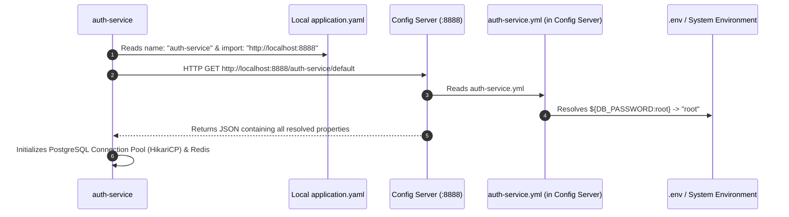
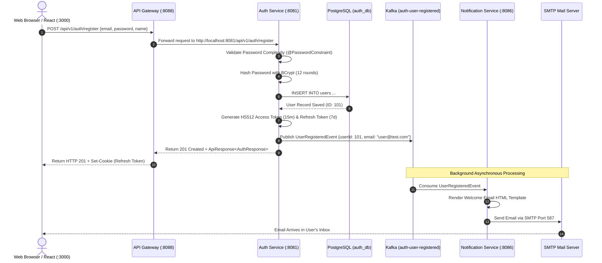

# The Definitive Microservices Master Handbook
### *From Absolute Zero to Enterprise Production: Concepts, Architecture, Code Mechanics & Teaching Guide*

**Project:** Fashion E-Commerce Distributed Platform  
**Target Audience:** Engineering Leads, Project Managers, Senior Developers, and Interns  
**Author:** PMRG Solution Engineering  

---

## 📑 Comprehensive Table of Contents

- [Chapter 1: Foundational Concepts — Monolith vs Microservices](#chapter-1-foundational-concepts--monolith-vs-microservices)
- [Chapter 2: The Build System — Maven Multi-Module Architecture](#chapter-2-the-build-system--maven-multi-module-architecture)
- [Chapter 3: Configuration & Secrets — `.env` vs `.yml` & Config Server](#chapter-3-configuration--secrets--env-vs-yml--config-server)
- [Chapter 4: Service Discovery — Netflix Eureka Deep-Dive](#chapter-4-service-discovery--netflix-eureka-deep-dive)
- [Chapter 5: Traffic Ingress & Routing — Spring Cloud API Gateway](#chapter-5-traffic-ingress--routing--spring-cloud-api-gateway)
- [Chapter 6: High-Speed In-Memory Operations — Redis 7](#chapter-6-high-speed-in-memory-operations--redis-7)
- [Chapter 7: Asynchronous Event-Driven Architecture — Apache Kafka (KRaft)](#chapter-7-asynchronous-event-driven-architecture--apache-kafka-kraft)
- [Chapter 8: Data Isolation & Persistence — PostgreSQL 16](#chapter-8-data-isolation--persistence--postgresql-16)
- [Chapter 9: Shared Code Strategy — `common-core` & `common-events`](#chapter-9-shared-code-strategy--common-core--common-events)
- [Chapter 10: Security Architecture — 512-bit JWT & Authentication](#chapter-10-security-architecture--512-bit-jwt--authentication)
- [Chapter 11: Local Cloud Emulation — LocalStack AWS S3](#chapter-11-local-cloud-emulation--localstack-aws-s3)
- [Chapter 12: End-to-End Request Lifecycles (Visual Traces)](#chapter-12-end-to-end-request-lifecycles-visual-traces)
- [Chapter 13: The Intern Training Curriculum (1-Hour Lesson Plan)](#chapter-13-the-intern-training-curriculum-1-hour-lesson-plan)
- [Chapter 14: The 10-Minute Manager Presentation Deck](#chapter-14-the-10-minute-manager-presentation-deck)
- [Chapter 15: 25 Essential Microservices Interview & Viva Questions](#chapter-15-25-essential-microservices-interview--viva-questions)

---

# Chapter 1: Foundational Concepts — Monolith vs Microservices

### 1.1 What is a Monolithic Architecture?
In a monolith, the entire application is compiled into a single archive (e.g. `fashion-ecommerce.war` or `app.jar`). The UI, authentication, product catalog, checkout, payment processing, email sending, and database access code all run inside **one single process on one server sharing one database**.

```
┌─────────────────────────────────────────────────────────────┐
│                    MONOLITHIC APPLICATION                   │
│                                                             │
│  [ Auth ]  [ Catalog ]  [ Orders ]  [ Payment ]  [ Email ]  │
│                                                             │
│              SHARED IN-MEMORY PROCESS (JVM)                 │
└──────────────────────────────┬──────────────────────────────┘
                               │
                               ▼
                   [( Single Shared Database )]
```

#### The Real-World Failure Modes of Monoliths:
1. **Single Point of Failure (Cascading Crash)**: If an intern writes an unoptimized loop in the Email Notification module that triggers an `OutOfMemoryError`, the **entire JVM crashes**. Customers cannot log in, browse products, or checkout.
2. **Scaling Inefficiency (Financial Waste)**: During Black Friday, 100,000 users browse dresses (Read-heavy on Catalog). In a monolith, to handle this load, you must duplicate the *entire* application 10 times across 10 expensive servers, copying unused modules like Payment and Reporting.
3. **Deployment Blockers**: A 2-line bug fix in the coupon code requires testing, building, and redeploying the entire 500,000-line monolith, increasing risk and deployment anxiety.
4. **Technology Lock-in**: If the monolith was started in Java 11, rewriting one performance-critical image processing module in Go or Python is practically impossible without rewriting everything.

---

### 1.2 What is a Microservices Architecture?
A microservice architecture decomposes a business domain into a suite of **small, autonomous, independently deployable services**, each running in its own process and communicating via lightweight protocols (HTTP/REST or Kafka events).

```
┌──────────────┐      ┌──────────────┐      ┌──────────────┐
│ auth-service │      │catalog-serv. │      │order-service │
│ (Port 8081)  │      │ (Port 8082)  │      │ (Port 8083)  │
└──────┬───────┘      └──────┬───────┘      └──────┬───────┘
       │ (Private DB)        │ (Private DB)        │ (Private DB)
       ▼                     ▼                     ▼
 [( auth_db )]         [(catalog_db)]        [( order_db )]
```

#### The Golden Principles of Microservices:
1. **Single Responsibility Principle (SRP)**: Each service does exactly one business capability well (e.g. `auth-service` manages identities; `order-service` manages checkout).
2. **Database-per-Service**: A service owns its database. No other service can query or join its tables directly.
3. **Decoupled Deployments**: `catalog-service` can be deployed 20 times a day without restarting `auth-service`.
4. **Resilience & Fault Isolation**: If `notification-service` crashes, orders are still placed and payments are still collected.

---

# Chapter 2: The Build System — Maven Multi-Module Architecture

### 2.1 Why `fashion-parent` Exists & Why It Is NOT a Spring Boot Project

```
                        fashion-parent (pom.xml)
                        [Packaging: POM aggregator]
                                     │
    ┌────────────────────────┬───────┴────────┬────────────────────────┐
    ▼                        ▼                ▼                        ▼
common-core          discovery-service   config-server            auth-service
(Library: JAR)         (App: Spring)     (App: Spring)           (App: Spring)
```

#### ❓ Question: *"Why is `fashion-parent` not a Spring Boot application with `@SpringBootApplication`?"*
* **Answer**: `fashion-parent` has `<packaging>pom</packaging>`. It is **not an executable application**; it is a **Meta-Project / Aggregator**.
* Its sole responsibility is to act as the single source of truth for library versions, compiler settings, and build plugins across all child projects.

---

### 2.2 `<dependencyManagement>` vs `<dependencies>` (The Critical Difference)

This is the most common confusion for junior developers.

| Feature | `<dependencies>` | `<dependencyManagement>` |
| :--- | :--- | :--- |
| **What it does** | **Actually downloads and includes** the JAR into the project's classpath. | **Declares and fixes version numbers** without downloading the JAR. |
| **Inheritance** | Child projects automatically get all dependencies forced on them. | Child projects only get the dependency **if they explicitly ask for it**, but they don't need to specify the version number. |
| **Where to use** | Use in child modules (`auth-service/pom.xml`) for libraries they actually use. | Use in parent module (`fashion-parent/pom.xml`) to standardize versions. |

#### Example in `fashion-parent/pom.xml`:
```xml
<!-- In Parent POM: We fix the version of common-core to 1.0-SNAPSHOT -->
<dependencyManagement>
    <dependencies>
        <dependency>
            <groupId>com.pmrgsolution</groupId>
            <artifactId>common-core</artifactId>
            <version>1.0-SNAPSHOT</version>
        </dependency>
    </dependencies>
</dependencyManagement>
```

#### Example in `auth-service/pom.xml`:
```xml
<!-- In Child POM: Notice NO <version> tag! It inherits 1.0-SNAPSHOT from parent -->
<dependencies>
    <dependency>
        <groupId>com.pmrgsolution</groupId>
        <artifactId>common-core</artifactId>
    </dependency>
</dependencies>
```

---

### 2.3 What is a BOM (Bill of Materials)?
A BOM is a special POM file that defines a curated list of compatible dependencies.
In our parent POM, we import two industry-standard BOMs:
1. **`spring-boot-dependencies` (v4.1.0)**: Manages compatible versions for Hibernate, PostgreSQL driver, Jackson, Tomcat, Netty, Redis driver, and Kafka client.
2. **`spring-cloud-dependencies` (v2025.1.2)**: Manages compatible versions for Eureka Server, Spring Cloud Gateway, Config Client, and OpenFeign.

**Why this matters**: Without BOMs, mixing versions (e.g. Spring Boot 3.2 with Spring Cloud 2021) results in `NoSuchMethodError` or `ClassNotFoundException` at runtime.

---

### 2.4 Maven Reactor Build Order
When you run `.\mvnw.cmd clean compile` in `fashion-parent`, Maven analyzes the dependencies between modules and creates a topological **Reactor Build Order**:
1. `fashion-parent` (Parent POM)
2. `common-core` (Base utility library - needed by everyone)
3. `common-events` (Kafka event schemas - needed by domain services)
4. `discovery-service` (Eureka)
5. `config-server` (Config repository)
6. `auth-service`, `api-gateway`, `catalog-service`, `order-service`, `payment-service`, `coupon-service`, `notification-service`

---

# Chapter 3: Configuration & Secrets — `.env` vs `.yml` & Config Server

### 3.1 `.env` vs `.yml`: The Clear Boundary

```
[ .env ] (Private Secrets & Hostnames) ──> [ Config Server YAMLs ] ──> [ Microservice Memory ]
DB_PASSWORD=root                            password: ${DB_PASSWORD:root}  spring.datasource.password
```

#### 1. `.env` (Environment-Specific Secrets & Infrastructure Targets)
* **What it contains**: Passwords, API keys, JWT secrets, database hostnames, SMTP passwords.
* **Why ONE file in parent**: Every developer has their own machine environment. Having one `.env` file prevents duplicating passwords across 6 folders.
* **Never commit real production `.env` to Git**: We commit `.env.example` as a template, while `.env` stays on the local machine or production server.

#### 2. `.yml` (Application Architecture & Framework Settings)
* **What it contains**: Hibernate dialect, Kafka topic serialization formats, Spring Cloud Gateway route paths, port numbers, cache TTLs.
* **Why it lives in `config-server`**: These settings represent the architecture of your system and stay identical across local and cloud environments.

---

### 3.2 How a Microservice Reads its Configuration on Startup



1. `auth-service` starts up with a tiny 5-line [`application.yaml`](file:///e:/sugaam/FashionEcommerce-Microservices/fashion-parent/auth-service/src/main/resources/application.yaml).
2. It sends an HTTP GET request to `http://localhost:8888/auth-service/default`.
3. `config-server` opens [`config-server/.../auth-service.yml`](file:///e:/sugaam/FashionEcommerce-Microservices/fashion-parent/config-server/src/main/resources/config/auth-service.yml).
4. `config-server` substitutes `${DB_HOST:localhost}` with environment variables from `.env`.
5. `config-server` returns the complete configuration as a JSON payload to `auth-service`.
6. `auth-service` configures its PostgreSQL DataSource, Redis client, and Kafka Producer in memory.

---

# Chapter 4: Service Discovery — Netflix Eureka Deep-Dive

### 4.1 What Problem Does Eureka Solve?

In production, microservices are deployed inside Docker containers or Kubernetes pods.
* Containers restart, crash, or scale dynamically.
* When `catalog-service` restarts, its IP might change from `10.0.1.5` to `10.0.2.19`.
* If `order-service` had hardcoded `http://10.0.1.5:8082`, calls would fail immediately.

**Eureka is the dynamic, self-healing phonebook of the entire ecosystem.**

```
                               ┌───────────────────────────────┐
                               │   EUREKA SERVER (Port 8761)   │
                               │                               │
                               │  AUTH-SERVICE    -> :8081     │
                               │  CATALOG-SERVICE -> :8082     │
                               │  API-GATEWAY     -> :8088     │
                               └───────────────▲───────────────┘
                                               │
                         ┌─────────────────────┴─────────────────────┐
                         │                                           │
             (1. Register on boot)                       (2. Heartbeat every 30s)
                         │                                           │
                ┌────────┴────────┐                         ┌────────┴────────┐
                │  auth-service   │                         │ catalog-service │
                │   (Port 8081)   │                         │   (Port 8082)   │
                └─────────────────┘                         └─────────────────┘
```

---

### 4.2 How Eureka Works Step-by-Step

1. **Self-Identification (`@EnableEurekaServer`)**:
   - `discovery-service` runs on port `8761`. It disables self-registration (`register-with-eureka: false`) so it doesn't clutter its own phonebook.
2. **Client Registration (`@EnableDiscoveryClient`)**:
   - When `auth-service` starts, the `spring-cloud-starter-netflix-eureka-client` background thread makes an HTTP REST call to `http://localhost:8761/eureka/apps/AUTH-SERVICE`.
   - Eureka records the hostname, IP address, port (`8081`), and healthcheck URL.
3. **Heartbeat Renewal (Liveness)**:
   - Every **30 seconds**, `auth-service` sends a lightweight heartbeat (`PUT /eureka/apps/AUTH-SERVICE/...`).
   - If Eureka does not receive a heartbeat for **90 seconds**, it assumes the service is dead and removes it from the registry.
4. **Registry Caching (High Availability)**:
   - Clients (like API Gateway) fetch the registry and **cache it locally**. Even if Eureka Server temporarily goes down, API Gateway can still route traffic to microservices using its cached copy!

---

# Chapter 5: Traffic Ingress & Routing — Spring Cloud API Gateway

### 5.1 Why Not Let Frontends Call Microservices Directly?

If your React web app directly called `http://localhost:8081` (Auth), `http://localhost:8082` (Catalog), and `http://localhost:8083` (Orders):
* **Security Risk**: You must expose 6 different ports to the public internet, multiplying firewall attack surfaces.
* **CORS Hell**: Every single microservice must configure complex CORS headers.
* **Client Complexity**: If a service port changes or moves to another server, the frontend code must be recompiled and redeployed.

---

### 5.2 Inside the API Gateway

```
[ CLIENT (Browser / Mobile) ]
             │
             │ (Calls http://localhost:8088/api/v1/...)
             ▼
┌─────────────────────────────────────────────────────────────┐
│                   API GATEWAY (Port 8088)                   │
│                                                             │
│  1. Route Predicate: Matches "/api/v1/auth/**"              │
│  2. Eureka Resolution: Finds healthy instance of AUTH-SERV  │
│  3. Global Filters: Rate Limit Check & CORS Headers         │
│  4. Forward: Dispatches request to target microservice      │
└──────────────────────────────┬──────────────────────────────┘
                               │
                               ▼
                    [ auth-service (:8081) ]
```

#### Why Netty instead of Tomcat for Gateway?
* **Traditional Spring MVC (Tomcat)**: Uses a **Thread-per-Request** model. 500 simultaneous requests require 500 active threads, consuming massive RAM (1 MB stack per thread = 500 MB).
* **Spring Cloud Gateway (Netty)**: Uses an **Event-Loop Non-Blocking I/O** model (similar to Node.js). A pool of only 4–8 threads can handle **20,000+ concurrent connections** effortlessly.

#### How `lb://` (Load Balancer) Works:
In `api-gateway.yml`:
```yaml
- id: catalog-service
  uri: lb://catalog-service
  predicates:
    - Path=/api/v1/products/**
```
* The `lb://` prefix instructs Spring Cloud LoadBalancer to query Eureka for all live instances of `catalog-service` and distribute incoming requests evenly (Round-Robin).

---

# Chapter 6: High-Speed In-Memory Operations — Redis 7

### 6.1 Disk (PostgreSQL) vs RAM (Redis)

| Metric | PostgreSQL 16 (Disk) | Redis 7 (In-Memory RAM) |
| :--- | :--- | :--- |
| **Storage Medium** | NVMe SSD / Hard Drive | RAM (Random Access Memory) |
| **Read Latency** | `10ms – 50ms` | `< 0.5ms` (100x faster) |
| **Throughput** | ~2,000 queries/sec | ~100,000+ operations/sec |
| **Best Used For** | ACID Transactions, relational data, long-term persistence | Ephemeral caches, rate limiting counters, token blacklists |

---

### 6.2 The JWT Stateless Dilemma & The Redis Blacklist Solution

```
User Clicks Logout ──> auth-service extracts JWT ID (jti = "abc-123")
                              │
                              ▼
                     Saves in Redis: "blacklist:abc-123" = "true" (TTL = 15 mins)
                              │
                              ▼
Next request using "abc-123" ──> Gateway checks Redis in 0.2ms ──> REJECTED (401 Unauthorized)
```

1. **The Dilemma**: JWT tokens are cryptographically self-contained. Once issued, a token is valid until its expiration timestamp. Even if a user logs out, the token string itself remains mathematically valid.
2. **The Wrong Solution**: Querying PostgreSQL on every single API request to check if a user is logged in destroys performance and defeats the purpose of stateless JWT.
3. **The Redis Solution**:
   - On Logout, `auth-service` extracts the JWT ID (`jti`) and stores `blacklist:{jti}` in Redis with a Time-To-Live (TTL) equal to the remaining expiry seconds.
   - When the token expires naturally, Redis **automatically deletes the key** from memory to keep RAM usage near zero.
   - The Gateway checks Redis in `< 0.5ms` before routing requests.

---

# Chapter 7: Asynchronous Event-Driven Architecture — Apache Kafka (KRaft)

### 7.1 Synchronous (REST) vs Asynchronous (Kafka Events)

```
[SYNCHRONOUS REST]
Client ──> [Order Service] ──(HTTP Wait...)──> [Payment Service] ──(HTTP Wait...)──> [Email Service]
*Total Latency: 200ms + 500ms + 1500ms = 2.2 SECONDS DELAY for the customer!*
*If Email Service is down, the entire order FAILS.*

[ASYNCHRONOUS KAFKA]
Client ──> [Order Service] ──> Saves Order & Publishes "OrderCreatedEvent" (0.05 seconds!)
                 │
                 ├──> Customer sees "Order Placed Successfully!" immediately!
                 │
                 └──> [Kafka Broker: topic 'order-created']
                               │
               ┌───────────────┴───────────────┐
               ▼                               ▼
       [Payment Service]              [Notification Service]
       Processes Payment              Sends Confirmation Email
```

---

### 7.2 Core Kafka Architecture Concepts

* **Producer**: The microservice that creates and sends an event (e.g. `auth-service` creates `UserRegisteredEvent`).
* **Topic**: An append-only log / queue where events are published (e.g. `auth-user-registered`).
* **Broker**: The Kafka server instance managing the storage and delivery of messages.
* **Consumer**: The microservice that reads and acts on events (e.g. `notification-service`).
* **Consumer Group**: A group of consumer instances sharing the workload. If 3 instances of `notification-service` run, Kafka ensures each email event is processed **exactly once**.
* **KRaft Mode (Kafka Raft)**: Modern Kafka replaces the legacy Apache Zookeeper cluster manager with an internal Raft consensus engine. It starts in 2 seconds, uses 70% less memory, and eliminates multi-container failure points.

---

# Chapter 8: Data Isolation & Persistence — PostgreSQL 16

### 8.1 The "Database-per-Service" Anti-Pattern vs Best Practice

```
❌ ANTI-PATTERN (Shared Database):
[auth-service] ───────┐
[catalog-service] ────┼───> [( Single Shared PostgreSQL Database )]
[order-service] ──────┘
*Danger: Catalog service can accidentally corrupt Auth tables; team schema migrations collide.*

✅ BEST PRACTICE (Database per Service):
[auth-service]      ───> [( auth_db )]
[catalog-service]   ───> [( catalog_db )]
[order-service]     ───> [( order_db )]
*Benefit: Complete autonomy. If auth_db is under heavy load, catalog_db performance is 100% unaffected.*
```

---

### 8.2 How `init-databases.sql` Works in Docker

When PostgreSQL starts inside Docker for the very first time:
1. Docker checks `/docker-entrypoint-initdb.d/`.
2. It executes [`init-databases.sql`](file:///e:/sugaam/FashionEcommerce-Microservices/fashion-parent/init-databases.sql) automatically.
3. The SQL script checks `WHERE NOT EXISTS` and safely creates all 6 individual databases (`auth_db`, `catalog_db`, `order_db`, `payment_db`, `coupon_db`, `notification_db`) in one startup pass.

---

# Chapter 9: Shared Code Strategy — `common-core` & `common-events`

### 9.1 The Golden Rule of Shared Libraries in Microservices
> **"Share generic enterprise plumbing and event contracts. NEVER share database entities or domain logic."**

If you share a `User` JPA entity between `auth-service` and `order-service`, any change to the User database table forces both services to be recompiled and redeployed together — creating a **Distributed Monolith**.

---

### 9.2 What Lives in `common-core` vs `common-events`

```
┌─────────────────────────────────────────────────────────────┐
│                         common-core                         │
│                                                             │
│  • ApiResponse<T> (Standard JSON envelope)                  │
│  • ErrorResponse & FieldError (Validation error standard)   │
│  • Exception Hierarchy (ResourceNotFound, ConflictException)│
│  • MaskingUtil (GDPR / PCI-DSS Log Masking)                 │
│  • CurrentUser (Security Context Holder)                    │
└─────────────────────────────────────────────────────────────┘

┌─────────────────────────────────────────────────────────────┐
│                        common-events                        │
│                                                             │
│  • UserRegisteredEvent (Auth -> Notification)               │
│  • OrderCreatedEvent (Order -> Payment, Notification)       │
│  • PaymentVerifiedEvent (Payment -> Order)                  │
│  • InventoryLowEvent (Catalog -> Admin Alerting)            │
│  • CouponRedeemedEvent (Order -> Coupon)                    │
└─────────────────────────────────────────────────────────────┘
```

---

# Chapter 10: Security Architecture — 512-bit JWT & Authentication

### 10.1 Why HMAC-SHA512 (HS512) with a 512-bit Secret Key?
* **HS256 vs HS512**: HS256 uses 256 bits (32 bytes). With modern GPU cracking rigs, brute-forcing weak 256-bit keys is possible.
* **HS512**: Uses **512 bits (64 bytes / 128 hexadecimal characters)**:
  ```text
  e2dcaa3c8476b7f56fd418ddcd3da1870e8f97978130f767ddc0f7344d2eb32d486ac86e16051e62203ae00d00807c00ab5203177c05952548f60247970c08b5
  ```
* Provides **\(2^{512}\)** possible key combinations — mathematically impossible to brute force even with quantum computing power.

---

### 10.2 The Dual-Token Lifecycle (Access vs Refresh Token)

```
┌─────────────────────────────────────────────────────────────┐
│              ACCESS TOKEN (Short-lived: 15 mins)            │
│  • Carried in HTTP Header: "Authorization: Bearer <token>"  │
│  • Stateless & Fast: Verified in memory without DB query    │
│  • If stolen by hacker: Expires in 15 minutes automatically │
└─────────────────────────────────────────────────────────────┘
                               ▲
                               │ (Silent Refresh via /auth/refresh)
                               │
┌─────────────────────────────────────────────────────────────┐
│              REFRESH TOKEN (Long-lived: 7 days)             │
│  • Stored in HttpOnly, Secure, SameSite=Strict Cookie       │
│  • JavaScript CANNOT read it (100% immune to XSS theft)     │
│  • Only used at /api/v1/auth/refresh to get new Access Token│
└─────────────────────────────────────────────────────────────┘
```

---

# Chapter 11: Local Cloud Emulation — LocalStack AWS S3

### 11.1 Why LocalStack?
* In an enterprise e-commerce platform, product photos, invoice PDFs, and user avatars are stored in **Amazon S3 (Simple Storage Service)** buckets, not on the web server's local hard drive.
* **The Problem**: Giving every developer and intern an active AWS account with credit card billing creates security risks and AWS cloud bills.
* **The Solution**: **LocalStack 3.8 Community** runs locally in Docker on port `4566`. It emulates the real AWS S3 REST API.
* Microservices upload files to `http://localhost:4566/fashion-ecommerce-assets` using the official AWS Java SDK with **zero AWS costs and 100% offline capability**.

---

# Chapter 12: End-to-End Request Lifecycles (Visual Traces)

### Trace: User Registration & Event Flow



---

# Chapter 13: The Intern Training Curriculum (1-Hour Lesson Plan)

Use this step-by-step agenda when onboarding new interns:

| Time | Module / Topic | Practical Exercise |
| :--- | :--- | :--- |
| **00:00 – 00:10** | **The Big Picture** | Explain Monolith vs Microservices using the Fashion E-Commerce diagram. |
| **00:10 – 00:20** | **Maven & The Parent POM** | Show `fashion-parent/pom.xml`. Explain `<dependencyManagement>` vs `<dependencies>`. |
| **00:20 – 00:30** | **Docker Infrastructure** | Run `docker compose -f docker-compose.infra.yml up -d`. Inspect Postgres, Redis, Kafka in `docker ps`. |
| **00:30 – 00:40** | **Service Discovery & Config** | Start `discovery-service` and `config-server`. Open `http://localhost:8761` and `http://localhost:8888/auth-service/default` in browser. |
| **00:40 – 00:50** | **API Gateway & Routing** | Start `api-gateway` on port `8088`. Show how routes map in `api-gateway.yml`. |
| **00:50 – 01:00** | **Q&A and Code Walkthrough** | Show `common-core` (`ApiResponse<T>`) and `common-events`. |

---

# Chapter 14: The 10-Minute Manager Presentation Deck

### Slide Outline for Leadership:

* **Slide 1: Business Objective**
  - Building a scalable, cloud-native Fashion E-Commerce platform with zero single-points-of-failure.
* **Slide 2: System Architecture**
  - Gateway (`:8088`) ➡️ Discovery (`:8761`) ➡️ Centralized Config (`:8888`) ➡️ 6 Autonomous Microservices ➡️ Docker Infrastructure.
* **Slide 3: Scalability & Performance Highlights**
  - **High Concurrency**: Netty Reactive Gateway handles 20,000+ simultaneous connections.
  - **Blazing Speed**: Redis 7 caching provides sub-millisecond data access.
  - **Event-Driven Resilience**: Kafka KRaft prevents checkout blockage during high-traffic notification processing.
* **Slide 4: Enterprise Security**
  - Military-grade 512-bit HMAC-SHA512 JWT authentication.
  - Dual-token architecture with `HttpOnly` refresh cookies protecting against XSS attacks.
  - Brute-force account lockout and rate limiting.
* **Slide 5: Cost & Developer Productivity**
  - 100% self-contained local development via Docker (Postgres, Redis, Kafka, LocalStack S3) with zero cloud vendor costs.
  - 100% Maven build success across all 12 modules.
* **Slide 6: Next Milestone**
  - Implementation of `auth-service` (User Registration, Login, RBAC, and Profile management).

---

# Chapter 15: 25 Essential Microservices Interview & Viva Questions

#### **Q1: Why is `fashion-parent` packaging set to `pom` instead of `jar`?**
* **Answer**: Because `fashion-parent` is a Maven Aggregator, not a runnable application. Its job is to manage dependencies and build lifecycle across submodules.

#### **Q2: What is the difference between Service Registration and Service Discovery?**
* **Answer**: *Registration* is when a microservice tells Eureka its IP on startup. *Discovery* is when another service (like Gateway) asks Eureka for the IP of a service to call it.

#### **Q3: What is the purpose of Spring Cloud Config Server?**
* **Answer**: To centralize application configuration outside the source code, enabling configuration updates across 10+ microservices in one place without rebuilding JARs.

#### **Q4: Why does Spring Cloud Gateway use Netty instead of Tomcat?**
* **Answer**: Netty uses non-blocking event loops, allowing thousands of concurrent requests with low memory, whereas Tomcat uses thread-per-request which exhausts memory under high concurrency.

#### **Q5: What happens if Kafka goes down while a user registers?**
* **Answer**: In our architecture, the user registration is saved in PostgreSQL first. Kafka failures can be captured in a transactional outbox table and retried when Kafka recovers, preventing user sign-up failure.

#### **Q6: Why is Redis preferred over PostgreSQL for JWT blacklisting?**
* **Answer**: Redis is in-memory and supports Time-To-Live (TTL). Blacklist checks take `< 0.5ms` compared to `20ms` in relational databases, and expired tokens are automatically purged without manual cron jobs.

#### **Q7: What is the difference between horizontal scaling and vertical scaling?**
* **Answer**: *Vertical scaling* means adding more CPU/RAM to a single server. *Horizontal scaling* means running multiple instances of a microservice (e.g. 3 `catalog-service` containers) behind a load balancer.

#### **Q8: What is the Database-per-Service pattern?**
* **Answer**: An architectural pattern where each microservice owns its private database. No service can directly query or modify another service's database tables.

#### **Q9: How does the Gateway load balance between multiple service instances?**
* **Answer**: Using the `lb://` URI scheme. Spring Cloud LoadBalancer fetches the list of healthy IPs from Eureka and applies a Round-Robin algorithm.

#### **Q10: Why do we use BCrypt for passwords instead of MD5 or SHA-256?**
* **Answer**: MD5 and SHA-256 are fast hash functions vulnerable to rainbow table attacks. BCrypt includes a cryptographic salt and configurable work factor (computational cost) that makes brute force infeasible.

#### **Q11: Why is LocalStack used in this project?**
* **Answer**: To emulate Amazon S3 locally in Docker, allowing developers to test product photo and invoice uploads without needing an AWS account or incurring cloud expenses.

#### **Q12: What does `optional:configserver:http://localhost:8888` mean?**
* **Answer**: It tells Spring Boot to attempt fetching properties from Config Server at that URI. If Config Server is unreachable, it logs a warning but falls back to local properties instead of crashing immediately.

#### **Q13: What is an API Gateway Predicate?**
* **Answer**: A boolean condition (e.g. `Path=/api/v1/products/**` or `Method=GET`) evaluated against incoming HTTP requests to determine which route matches.

#### **Q14: What is CORS and why is it handled at the Gateway?**
* **Answer**: Cross-Origin Resource Sharing is a browser security mechanism blocking web pages from making requests to a different domain/port. Configuring it at the Gateway handles it globally for all services.

#### **Q15: Why is Kafka in KRaft mode better than Zookeeper mode?**
* **Answer**: KRaft mode manages metadata internally via Raft consensus, eliminating the extra Zookeeper container, reducing memory usage, and improving recovery speed.

#### **Q16: What is a Circuit Breaker in microservices?**
* **Answer**: A resilience pattern that detects failures in a downstream service and temporarily trips open, returning a fallback response instead of hanging threads and causing cascading system failure.

#### **Q17: Why do we keep `common-core` as a separate JAR module?**
* **Answer**: To share common DTOs (`ApiResponse`), exception classes, and security utilities across all services without copy-pasting code.

#### **Q18: What is the purpose of `MaskingUtil` in `common-core`?**
* **Answer**: To mask sensitive data (credit cards, passwords, emails) before printing to application log files, ensuring compliance with GDPR and PCI-DSS standards.

#### **Q19: How does the Refresh Token prevent XSS (Cross-Site Scripting) attacks?**
* **Answer**: It is stored in an `HttpOnly` cookie which cannot be accessed by browser JavaScript (`document.cookie`), preventing malicious scripts from stealing the token.

#### **Q20: What is a Distributed Transaction and how is it handled in microservices?**
* **Answer**: A transaction spanning multiple services and databases (e.g. Order + Payment + Inventory). It is handled using the **Saga Pattern** with compensating transactions or Kafka events rather than two-phase commit (2PC).

#### **Q21: What is the difference between synchronous Feign client and asynchronous Kafka message?**
* **Answer**: Feign is blocking (caller waits for HTTP response); Kafka is non-blocking (publisher sends message and continues without waiting for consumers).

#### **Q22: Why did we update the API Gateway port to `8088`?**
* **Answer**: To prevent port collision with Apache, XAMPP, or Oracle XE services that commonly occupy port `8080` on developer Windows machines.

#### **Q23: What does `@EnableEurekaServer` do?**
* **Answer**: It activates the Netflix Eureka server configuration, turning the Spring Boot application into a service registry that listens for client registrations and heartbeats.

#### **Q24: What is the purpose of `.env.example`?**
* **Answer**: It serves as a version-controlled documentation template showing all required environment variables and placeholders without exposing real secrets in Git.

#### **Q25: What is the startup sequence for this microservices platform?**
* **Answer**:
  1. Docker Infrastructure (Postgres, Redis, Kafka, LocalStack).
  2. `discovery-service` (Eureka on `:8761`).
  3. `config-server` (Config on `:8888`).
  4. `api-gateway` (Gateway on `:8088`).
  5. Business Microservices (`auth-service`, `catalog-service`, etc.).
